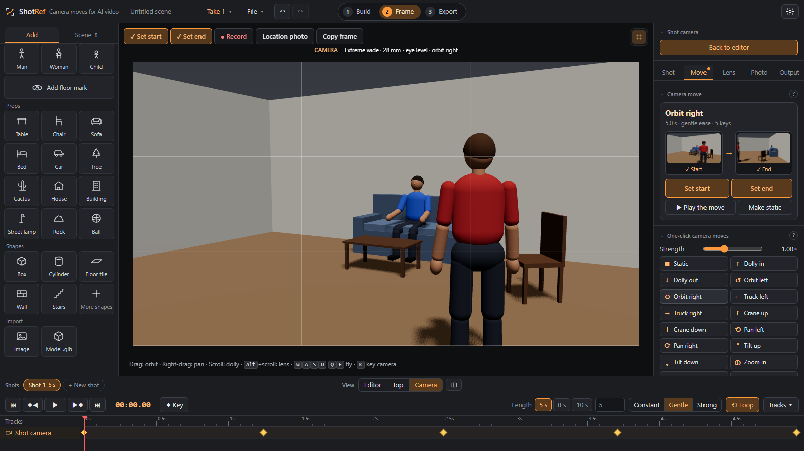
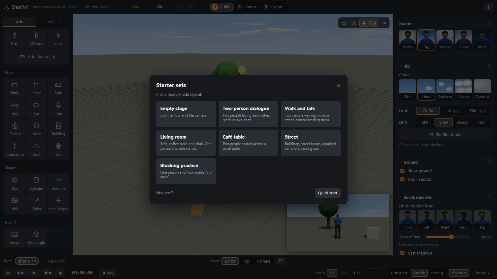
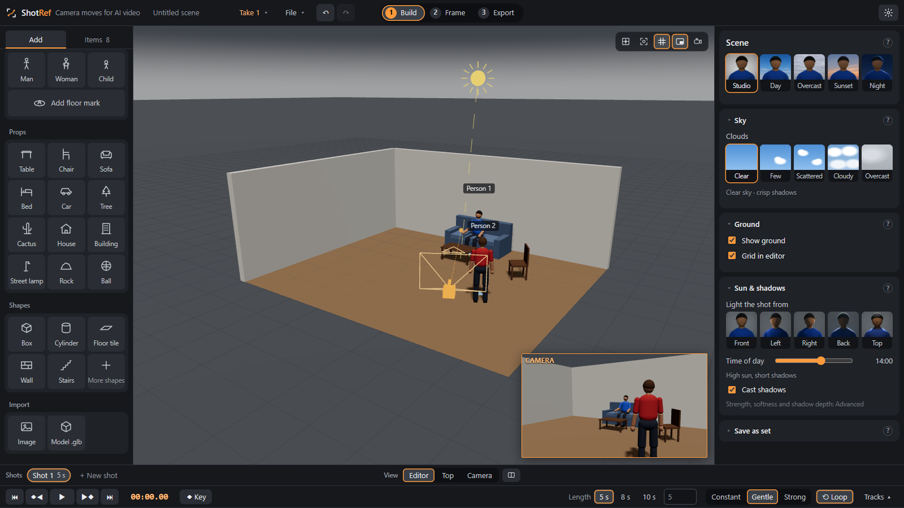
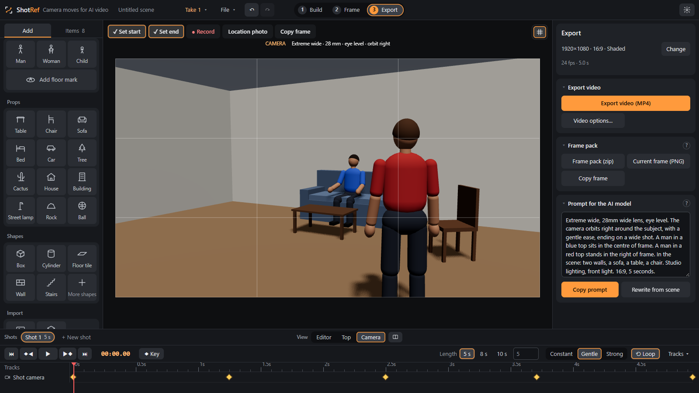
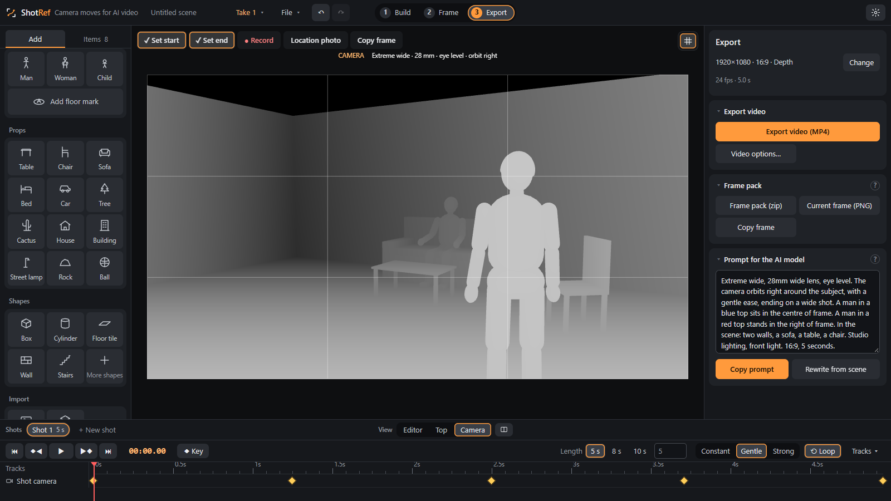
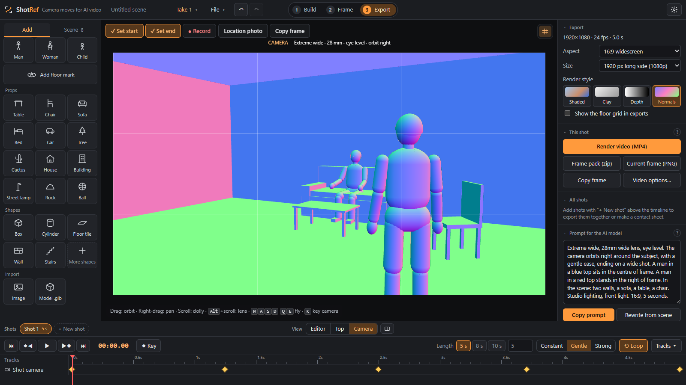

<p align="center">
  
</p>

<h1 align="center">ShotRef</h1>

<p align="center"><b>Block the shot. Move the camera. Guide the AI.</b></p>

<p align="center">
  A simple 3D tool for blocking scenes and camera moves, then exporting reference clips and frames for AI video models like Kling, Runway, Veo and Higgsfield.<br>
  No 3D skills needed. Free. Works offline.
</p>

<p align="center">
  <a href="https://github.com/alistotleLB/ShotRef/releases/latest"></a>
  <a href="LICENSE"></a>
  
</p>

<p align="center">
  <a href="https://github.com/alistotleLB/ShotRef/releases/latest"><b>⬇ Download</b></a> ·
  <a href="docs/GUIDE.md">User guide</a> ·
  <a href="#quick-start">Quick start</a>
</p>

<p align="center">
  
</p>

## Why ShotRef

AI video models are good at looks and bad at following directions. Describe "a slow orbit around two people on a sofa" and you get something close, maybe. Show the model a clip with the exact move and the exact blocking, and you get much closer.

ShotRef is for that. Put simple mannequins and props on a floor, set where the camera starts and ends, and export a clean reference clip, start and end frames, or depth and normal passes. Use them as the first frame, as a video reference, or as a guide for the prompt. It is a "very dumbed-down Blender" for blocking and camera moves, and nothing else, so you can do a shot in minutes.

It was made by a TV producer and videographer, for people who think in shots, not in meshes. The words in the app are the ones on set: dolly, truck, crane, rack focus, mark.

## What you can do

- **Learn it in minutes.** A quick guided tour of the screen, always in the Help menu.
- **Start from a set.** Two-person dialogue, walk and talk, living room, café table, street, blocking practice. Or an empty stage.
- **Place people and props.** Men, women and children, tables, chairs, sofas, cars, trees, buildings, and basic shapes. Bring in your own `.glb` models and a location photo.
- **Block the action.** Draw walk paths, send people to floor marks with an arrival time, sit them on a chair or sofa, change pose mid-shot, and make them look at the camera.
- **Move the camera.** Pick a one-click move (dolly in or out, orbit, truck, crane, pan, tilt, zoom, drone rise, reveal), set a start and an end, or press Record and fly it live. Reshape the path by dragging its points.
- **Real lens controls.** Focal length in mm, depth of field with click-to-focus, rack focus, dutch roll, handheld shake, and ease in and out.
- **Light it.** Time of day, sun direction and shadows, or a preset: Studio, Day, Overcast, Sunset, Night.
- **Try versions.** Takes keep alternative versions of a scene. Shots hold several camera setups on the same scene.
- **Export what the AI needs.**
  - MP4 of the shot, from 720p up to 4K, in 16:9, vertical and other aspect ratios
  - PNG of any frame, or a **frame pack** (start, middle and end frames plus the prompt) for image-to-video models
  - A **contact sheet** of every shot
  - Render styles: shaded, clay, **depth** and **normals**
  - A **prompt writer** that describes the shot in plain words from your scene
- **Never lose work.** Autosave, undo and redo, and Recent projects. Projects save as small `.shotref` files.

## Screenshots

<table>
  <tr>
    <td width="50%"><br><sub><b>Start a shot.</b> Pick a starter set or an empty stage.</sub></td>
    <td width="50%"><br><sub><b>1 · Build.</b> Drag people and props around. The camera view stays in the corner.</sub></td>
  </tr>
  <tr>
    <td width="50%"><br><sub><b>2 · Frame.</b> Set a start and an end, or pick a one-click move.</sub></td>
    <td width="50%"><br><sub><b>3 · Export.</b> MP4, frames, and a prompt written from your scene.</sub></td>
  </tr>
  <tr>
    <td width="50%"><br><sub><b>Depth pass</b> for depth-guided video models.</sub></td>
    <td width="50%"><br><sub><b>Normals pass.</b> Same shot, same move.</sub></td>
  </tr>
</table>

## Download

Get the latest build from the **[Releases page](https://github.com/alistotleLB/ShotRef/releases/latest)**.

| You want | Download | Notes |
|---|---|---|
| Windows app, installs like normal | `ShotRef-Setup-<version>.exe` | Start menu entry, double-click `.shotref` files to open them |
| Windows app, no install | `ShotRef-<version>-portable.exe` | Run it from anywhere, for example a USB stick |
| Any computer with Chrome or Edge | `ShotRef.html` | One file. Double-click it. Works offline. Mac and Linux users use this one |

> **Windows says "Windows protected your PC".** The Windows builds are not code-signed yet, so SmartScreen warns about any new app. Click **More info**, then **Run anyway**. The whole source is in this repository, and you can build the same files yourself (see [docs/DEVELOPING.md](docs/DEVELOPING.md)).

ShotRef never connects to the internet. Your scenes, photos and models stay on your computer.

## Quick start

1. **Start from a set.** Open ShotRef and pick a starter set, or click an item on the left and then click the floor to place it.
2. **Block it.** Drag people and props across the floor. Drag the orange ring to turn them. Press `T` for a top-down floor plan.
3. **Move people.** Select a person, press **Draw walk path** and click points on the floor. Drag them onto a chair to sit them down.
4. **Frame the shot.** Press `C` for camera view. Drag to orbit, scroll to dolly, `W A S D Q E` to fly.
5. **Make the move.** Press **Set start**, reframe, then **Set end**. Or pick a one-click move such as **Orbit right** or **Dolly in**.
6. **Export.** Press `3`. Render the MP4, grab the frame pack, and copy the prompt.

The full walkthrough, shortcuts and tips are in the **[user guide](docs/GUIDE.md)**.

## Using it with AI video tools

- **Image-to-video** (Kling, Runway, Veo, Higgsfield and similar): export the **frame pack**. Use the start frame as the first frame, and paste the prompt ShotRef wrote.
- **Video-to-video and motion references:** render the **MP4** and upload it as the reference clip.
- **Depth-guided workflows:** switch the render style to **Depth** or **Normals** before exporting.
- Every tool has its own limits on length, size and features. Check yours, then match the **Aspect** and **Length** in ShotRef's Export step.

ShotRef is not affiliated with any of these tools.

## FAQ

**Do I need to know 3D?** No. The mannequins are simple on purpose. If you can place a camera on a set, you can use ShotRef.

**Is it really free?** Yes. It is open source under the MIT license.

**Does it need an account or internet?** No, neither.

**Where are my projects?** Your work is autosaved in the app. Use **File, Save** to keep a `.shotref` file you can back up or send to someone.

**Why mannequins and not realistic people?** ShotRef is for blocking and camera moves. The AI model supplies the look. A plain figure is faster to place and keeps the model focused on the move.

**Something broke.** Please [open an issue](https://github.com/alistotleLB/ShotRef/issues). Say what you did, what happened, and attach the `.shotref` file if you can.

## Build from source

You need [Node.js](https://nodejs.org) 18 or newer.

```bash
npm install
npm run build   # writes dist/ShotRef.html
```

More about the code, tests and the Windows build is in [docs/DEVELOPING.md](docs/DEVELOPING.md).

## Credits and license

ShotRef is released under the [MIT license](LICENSE).

Built with [three.js](https://threejs.org) for 3D, [mp4-muxer](https://github.com/Vanilagy/mp4-muxer) for MP4 files, [esbuild](https://esbuild.github.io) and [Electron](https://www.electronjs.org) for the Windows app.
