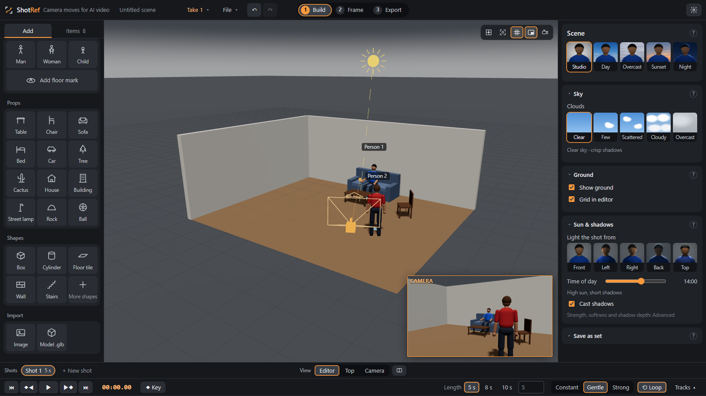
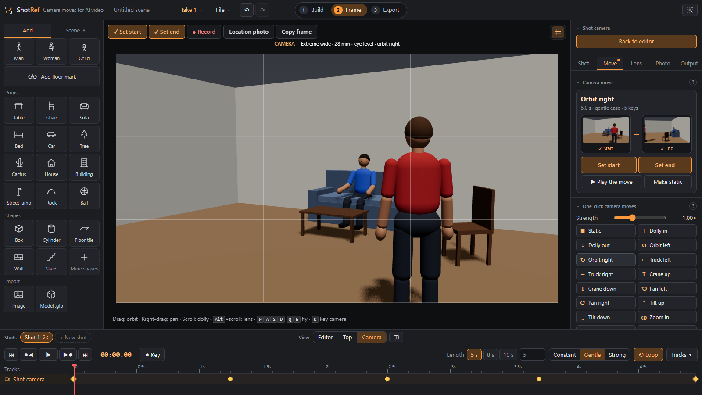
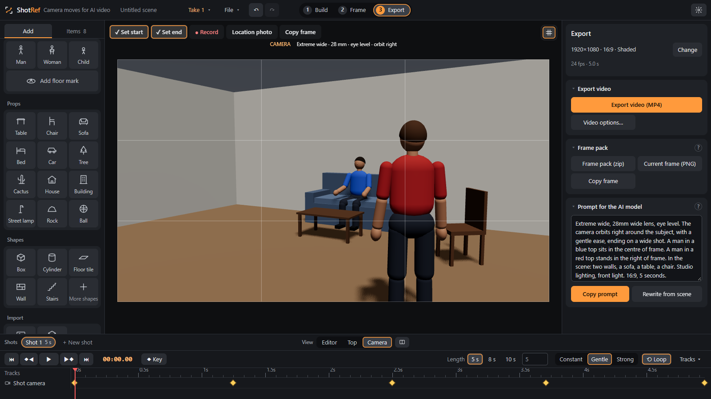

# ShotRef user guide

ShotRef helps you plan a shot and hand it to an AI video model. You build a rough set, move the camera, and export a clip or frames. This guide covers the basics. Everything is also in the app: press the **?** on any panel heading, or open **Quick start** from the welcome screen.

**Contents**
[Tours](#tours) · [The three steps](#the-three-steps) · [1. Build](#1-build-the-scene) · [2. Frame](#2-frame-the-shot-and-move-the-camera) · [3. Export](#3-export) · [Shots, takes and sets](#shots-takes-and-sets) · [Saving](#saving-and-opening) · [Shortcuts](#shortcuts) · [Advanced controls](#advanced-controls) · [Troubleshooting](#troubleshooting)

## Tours

ShotRef has a guided **quick tour** with 10 stops. It points out each part of the screen and changes nothing.

The first time you open ShotRef, a window asks **Take a look round the set?** Choose **Take the quick tour** or **Not now**. After that, the tour is in the **Help** menu: in the browser, under **Help** in the gear menu, and in the Windows app, the **Help** menu. It is also at the top of the **Quick start** page.

Press `Esc` or **End tour** to stop a tour at any time.

## The three steps

The bar at the top has three steps. Press `1`, `2` or `3` to jump between them.

| Step | What you do |
|---|---|
| **1 · Build** | Place people and props. Move them. Set the light. |
| **2 · Frame** | Look through the camera, then set where it starts and ends. |
| **3 · Export** | Render the video or frames and copy the prompt. |

You have three **views**. The **View** buttons are in the row under the picture, between the Shots chips and the Contact sheet button. Use whichever suits the job.

| View | Key | Use it for |
|---|---|---|
| **Editor** | | Walking around the set from outside |
| **Top** | `T` | A floor plan. Good for placing people and drawing paths |
| **Camera** | `C` | What the shot sees. Good for framing |

The small **split view** button next to them shows the editor on the left and the camera on the right. The half your pointer is over is the one you steer.

## 1. Build the scene

**Start from a set.** On first launch, or from **File, New**, pick a starter set: Two-person dialogue, Walk and talk, Living room, Café table, Street, Blocking practice, or an empty stage. Everything in a set can be moved, changed or deleted.

**Add things.** Click an item on the **Add** tab on the left, then click the floor to place it. There are people (man, woman, child), floor marks, furniture and props, and basic shapes. **Import** lets you bring in a location **Image** or a **Model .glb** of your own.

**Move things.** Drag across the floor. Drag the orange **ring** to turn someone. Let go over another person or the camera and they turn to face it. Hold `Shift` and click to select several, or drag a box on empty space. `Ctrl G` groups the selection. `Ctrl L` locks it so it can't be dragged by accident.

**Right-click anything** to see what you can do: add a person here, walk them to a mark, face the camera, frame a medium shot, duplicate, hide.

**Move people.**
- Select a person, press **Draw walk path** and click points on the floor. Press `Enter` to finish. Their feet are matched to their speed.
- Or send them to a **floor mark** with an arrival time.
- Drag a person onto a chair, sofa or bed to sit them down. Drag them away to stand.
- Choose a different pose later in the shot to change it mid-shot. It shows as a blue tag on the timeline.
- The eye button over a person makes them look at the camera.

**Light.** The **Scene** panel has presets (Studio, Day, Overcast, Sunset, Night) and a **Time of day** slider. Drag the yellow sun in the editor to turn the light and the shadows.

**Location photo.** In **Frame**, open the **Photo** tab to put a photo behind your scene as a location. Useful when you want the AI to match a real place.

## 2. Frame the shot and move the camera

Press `C` for camera view.

**Steer the camera.**
- Drag to orbit, right-drag to pan, scroll to dolly in and out.
- `W A S D Q E` fly the camera. `Alt` plus scroll changes the lens.
- Or pick a shot size: Wide, Medium, Close-up and so on.

**Make the move.** There are three ways, pick any:

1. **Set start, then Set end.** Frame the first moment and press **Set start**. Frame the last and press **Set end**. ShotRef moves the camera between them.
2. **One-click moves.** Dolly in, Dolly out, Orbit left and right, Truck left and right, Crane up and down, Pan, Tilt, Zoom in, Dolly zoom, Arc and push, Drone rise, Reveal. **Strength** makes the move bigger or smaller.
3. **Record.** Press **Record** and fly the camera live. ShotRef keeps what you did.

Press **Play the move** or `Space` to watch it. Drag the yellow points on the camera path to reshape it. Right-click the path to add a point.

**Camera tabs.** The panel on the right has **Shot**, **Move**, **Lens**, **Photo** and **Output**.
- **Lens:** focal length in mm, depth of field, and focus. Double-click anything in the picture to focus on it. Double-click something else later to pull focus.
- **Move:** motion feel (**Constant**, **Gentle**, **Strong**) and handheld shake.
- The camera can also **look at** a person or ride on an object, such as a car.

**Length.** The bar under the picture sets the shot length (5 s, 8 s, 10 s or your own).

## 3. Export

Press `3`.

| Button | You get |
|---|---|
| **Render video (MP4)** | The whole shot as an MP4, rendered frame by frame. If your browser can't do MP4, you get a WebM instead |
| **Current frame (PNG)** | The frame at the playhead |
| **Frame pack (zip)** | Start, middle and end frames, plus the prompt |
| **Copy frame** | The current frame on your clipboard, ready to paste |
| **Contact sheet** | One image with every shot, when you have several |

Choose **Aspect** (16:9, 9:16 vertical, 1:1, 4:5, 4:3, 2.39:1, 21:9) and **Size** (720p up to 4K) at the top of the panel.

**Render style.**
- **Shaded** is the normal look.
- **Clay** is plain grey, to keep the AI from copying the colours.
- **Depth** and **Normals** are guide passes for tools that take depth or normal input.

**Prompt for the AI model.** ShotRef writes a short description of the shot from your scene: lens, camera move, who is where, and the light. Edit it, then press **Copy prompt**. **Rewrite from scene** starts again from what is in the scene now.

### Which export for which kind of AI tool?

| Your tool takes | Export |
|---|---|
| A first frame (image-to-video) | The **Frame pack**. Use the start frame and the prompt |
| First and last frame | The start and end frames from the **Frame pack** |
| A reference video | The **MP4** |
| Depth or normal maps | The **MP4** or frames, with the **Depth** or **Normals** style |

Every tool has its own limits on length, size and file type. Set **Aspect** and **Length** to match.

## Shots, takes and sets

- **Shots** are different camera setups on the same scene. Add one with **+ New shot** above the timeline. Each has its own camera and length. Export one shot or all of them.
- **Takes** are alternative versions of the whole scene. Use the **Take** button at the top to make a copy, try something, and switch back.
- **My sets** (on the Add tab) keep a layout you use again and again.

## Saving and opening

Your work is **autosaved in the app**, but a file is safer. Use **File, Save** (`Ctrl S`) to write a `.shotref` project file. Open one with **File, Open** (`Ctrl O`). In the Windows app you can also double-click a `.shotref` file. **Recent projects** lists what you worked on lately.

Project files hold your photos and models, so they can be moved to another computer.

## Updates (Windows app)

The installed Windows app looks for a new version a few seconds after it starts. If there is one, it asks whether to download it, then whether to restart now or install when you next close ShotRef. ShotRef asks about unsaved work before it closes, and your projects are not touched.

- **Help, Check for updates…** checks on demand.
- **Help, Check for updates automatically** switches the check on launch off.
- After an update, ShotRef shows **What's new**: every change since the version you had. **Help, What's new** shows it again for this version.
- The portable version can't update itself. It opens the download page instead.
- The browser version (`ShotRef.html`) has no updater: download the new file from the [Releases page](https://github.com/alistotleLB/ShotRef/releases/latest).

## Shortcuts

| Key | What it does |
|---|---|
| `Space` | Play or pause |
| `1` `2` `3` | Build, Frame, Export |
| `C` · `T` | Camera view · Top view |
| `K` | Add a key for the selection (the camera, in camera view) |
| `←` `→` | Step one frame (`Shift`: ten frames) |
| `Home` `End` | Go to start · end |
| `F` | Zoom the view to the selection |
| `Enter` · `Esc` | Finish a path · cancel placing, a path or a recording |
| `Ctrl Z` · `Ctrl Y` | Undo · redo |
| `Ctrl D` · `Del` | Duplicate · delete |
| `Ctrl G` · `Ctrl Shift G` | Group · ungroup |
| `Ctrl L` | Lock or unlock |
| `Ctrl A` | Select everything |
| `Ctrl S` · `Ctrl O` | Save · open |
| `P` · `Ctrl C` | Save the current frame as PNG · copy it |
| Right-click | A menu for what is under the pointer |
| Double-click (camera view) | Focus the lens on it |

## Advanced controls

The app hides detail you rarely need. Open the **gear menu** at the top right and turn on **Advanced controls** for numeric fields, keyframe tools and the move, rotate and scale arrows (`W` `E` `R`).

## Troubleshooting

**Windows says "Windows protected your PC."** The app isn't code-signed yet. Click **More info**, then **Run anyway**.

**The MP4 button gives me a WebM.** Your browser does not support MP4 encoding. Use a recent Chrome or Edge, or the Windows app.

**Export takes a while.** ShotRef renders every frame at full quality. A 10-second, 24 fps clip is 240 frames, and 4K takes longer than 720p. The page is locked while it works.

**The picture is black or won't draw.** Your graphics driver may have reset. Wait a moment, or reload the page. Your work is autosaved.

**I opened ShotRef in two tabs.** ShotRef warns you. Two tabs share one autosave, so close one.

**Anything else.** [Open an issue](https://github.com/alistotleLB/ShotRef/issues) and attach your `.shotref` file if you can.
