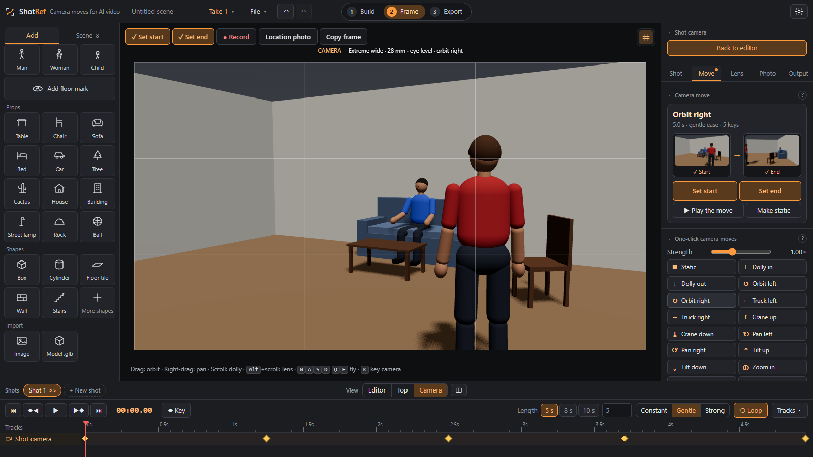

## ShotRef 1.2.0

**Block the shot. Move the camera. Guide the AI.**

ShotRef is a simple 3D tool for blocking scenes and camera moves, then exporting reference clips and frames for AI video models. No 3D skills needed, free, and it works offline.

### Download

| You want | File |
|---|---|
| Windows app with installer | `ShotRef-Setup-1.2.0.exe` |
| Windows app, no install | `ShotRef-1.2.0-portable.exe` |
| Any computer with Chrome or Edge | `ShotRef.html` (one file, double-click it) |

The Windows builds are not code-signed yet, so Windows SmartScreen may say "Windows protected your PC". Click **More info**, then **Run anyway**.

### What's in 1.2.0

- Right-click menus on everything: add a person here, walk them to a mark, frame a medium shot, face the camera
- Double-click the picture to focus the lens, with depth of field
- A three-step flow: **Build**, **Frame**, **Export**
- Takes (alternative versions of a scene) and several shots per scene, with a shot bar and compare
- Export panel with an AI prompt written from your scene, a frame pack (start, middle, end frames plus the prompt), a contact sheet, and render styles: shaded, clay, depth and normals
- Multi-select, lock and groups
- People with body types, eyeline, sitting, and pose changes mid-shot
- Parenting, ground rules and a camera that rides on an object
- Camera tabs for Shot, Move, Lens, Photo and Output, with Sun and time of day
- My sets, Recent projects, Settings and split view
- Keeps every shot's camera in place when an object it was using is deleted
- Help (?) and collapsible sections on every panel

### Known issues

- Walking feet can slide slightly at heel strike.

Guide: [docs/GUIDE.md](https://github.com/alistotleLB/ShotRef/blob/main/docs/GUIDE.md)
